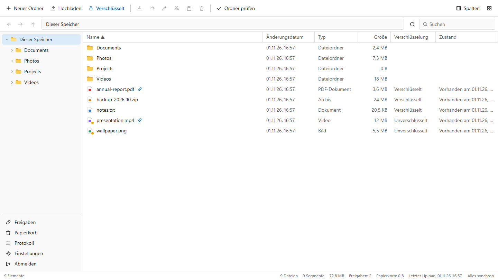
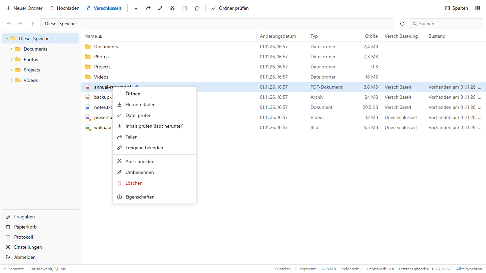
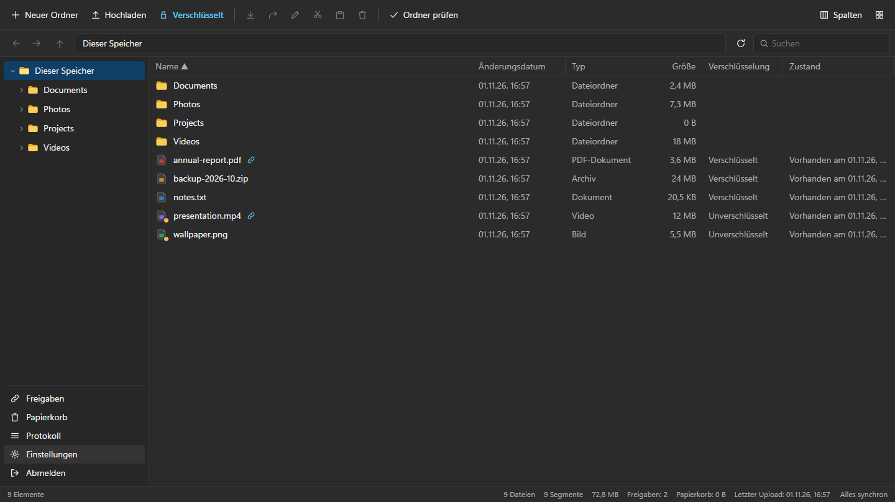
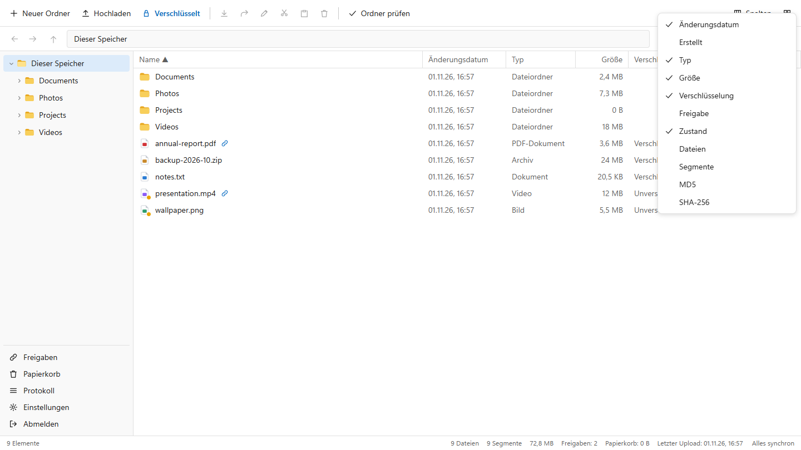
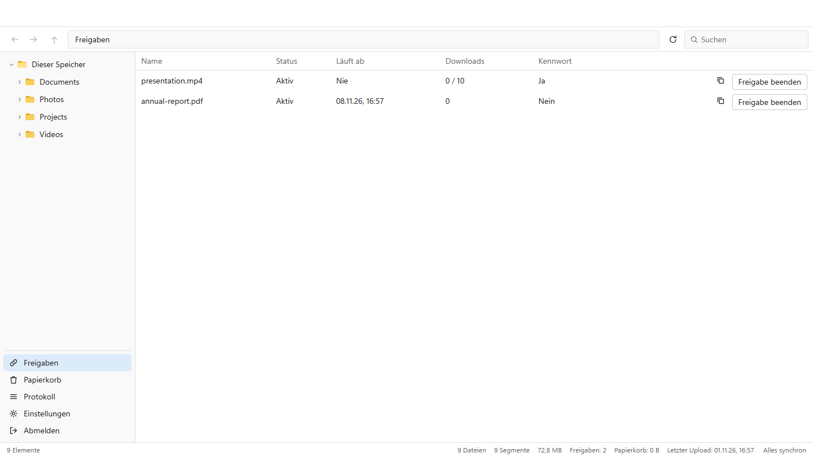
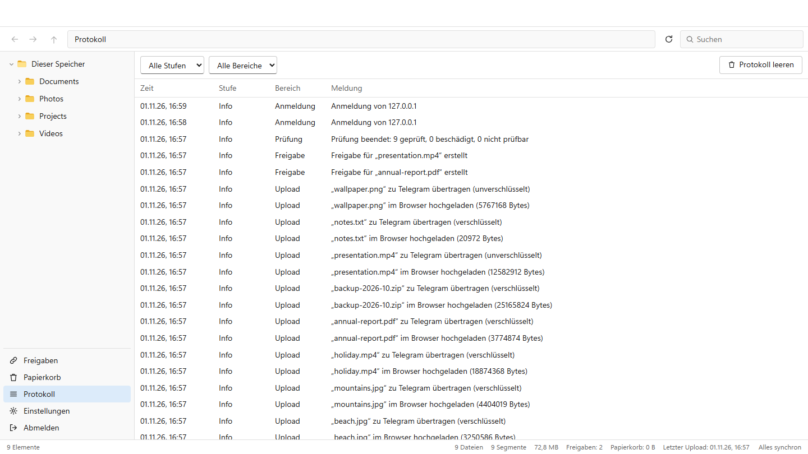
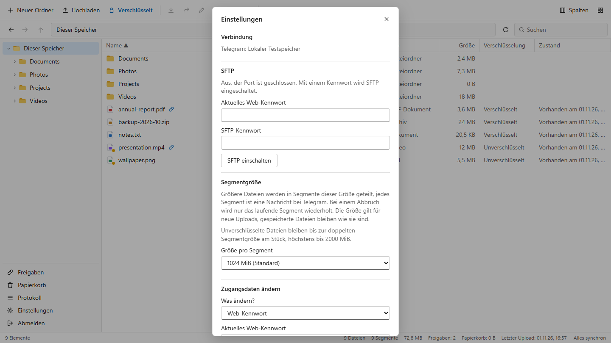
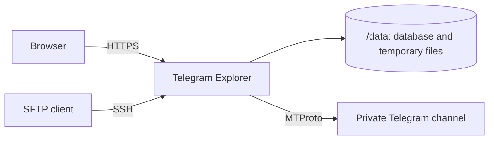

# Telegram Explorer

A self-hosted file manager with a Windows Explorer look that uses your own Telegram account as storage. Upload large files, sort them into folders, share them by link and reach them over SFTP. Files can be encrypted so that Telegram only ever sees random data.



> **Telegram is not a backup.** If your account is banned or the storage channel is deleted, your files are gone. Keep a second copy of anything important.

> **Language:** the user interface is currently available in German only.

## Contents

- [Features](#features)
- [Screenshots](#screenshots)
- [Quick start](#quick-start)
- [Configuration](#configuration)
- [Reverse proxy](#reverse-proxy)
- [Using it](#using-it)
- [SFTP](#sftp)
- [Encryption](#encryption)
- [How files are stored](#how-files-are-stored)
- [Operations](#operations)
- [Limitations](#limitations)
- [Development](#development)

## Features

- **Explorer interface:** folder tree, list and grid view, drag and drop, cut and paste, context menus, search, preview, light and dark mode (following the system or chosen by hand), and a layout that works on phones.
- **Large files:** files of any size are split into segments. Uploads resume after an interruption and failed transfers are retried. Each file shows whether it is on its way to the server, on its way to Telegram or finished.
- **Optional encryption:** encrypted files are unreadable to Telegram. Unencrypted files stay normal documents you can download directly in Telegram.
- **Sharing:** public links with optional password, a lifetime from one minute to 100 years, and a download limit. Links open images, videos and PDFs directly. Shared files are marked in the list, and a share can be changed or ended at any time, including a new link.
- **Speed limits:** separate limits for traffic to and from Telegram. The status bar shows the current speed and switches the limit with one click.
- **SFTP:** browse, upload and download with any SFTP client. It stays off until you switch it on.
- **File checks:** a quick check asks Telegram whether a file still exists, without a download. A full check downloads it and compares checksums.
- **Configurable columns:** date, type, size, encryption, sharing, state, file count, segment count, MD5 and SHA-256.
- **Activity log:** uploads, downloads, shares, deletions, checks, logins, warnings and errors.
- **Trash:** deleted files stay for 30 days. A final delete also removes them from Telegram right away.
- **Automatic metadata backups:** an encrypted copy of the database is stored in your Telegram channel.
- **Account protection:** login rate limiting and optional two-factor authentication (TOTP).
- **Small footprint:** one Go binary with an embedded web interface and SQLite. No external database is required.

## Screenshots

| | |
|---|---|
|  |  |
| Context menu with file actions | Dark mode |
|  |  |
| Selectable columns | Shares with status and limits |
|  |  |
| Activity log | Settings |

The screenshots show made-up demo data.

## Quick start

You need Docker with Compose and a Telegram account. A free account is enough.

**1. Get your Telegram API credentials.** Sign in at [my.telegram.org](https://my.telegram.org), open *API development tools* and create an application. Note the `api_id` and `api_hash`.

**2. Download the example files.**

```bash
mkdir telegram-explorer && cd telegram-explorer
```

```bash
curl -O https://raw.githubusercontent.com/syncip/telegram-explorer/main/docker-compose.yml
```

```bash
curl -o .env https://raw.githubusercontent.com/syncip/telegram-explorer/main/.env.example
```

**3. Enter your credentials** in `.env`:

```ini
TG_APP_ID=1234567
TG_APP_HASH=0123456789abcdef0123456789abcdef
```

**4. Start the container and read the setup code from the log.**

```bash
docker compose up -d
```

```bash
docker compose logs telex
```

**5. Finish the setup.** Open <http://127.0.0.1:8080>, enter the setup code and choose a username, a password and an encryption passphrase. Then sign in to Telegram with your phone number. The app creates a private channel called *Telegram Explorer Storage*.

After every restart the passphrase has to be entered once in the browser. Until then, uploads, shares and SFTP are inactive.

> **Keep your passphrase safe.** Without it, encrypted files are lost. Nobody can reset it.

### Example `docker-compose.yml`

```yaml
services:
  telex:
    image: r600/telegram-explorer:latest
    container_name: telegram-explorer
    restart: unless-stopped
    env_file: .env
    ports:
      # The web UI belongs behind an HTTPS reverse proxy, hence localhost only.
      - "127.0.0.1:8080:8080"
      # Stays closed until SFTP is switched on in the settings.
      - "2222:2222"
    volumes:
      - telex-data:/data
    read_only: true
    tmpfs:
      - /tmp
    cap_drop:
      - ALL
    security_opt:
      - no-new-privileges:true

volumes:
  telex-data:
```

### Updating

```bash
docker compose pull
```

```bash
docker compose up -d
```

Database changes are applied automatically at startup.

## Configuration

Settings are read from environment variables, usually through `.env`.

| Variable | Default | Description |
|---|---|---|
| `TG_APP_ID` | | Telegram API ID. Required with the `telegram` backend. |
| `TG_APP_HASH` | | Telegram API hash. Required with the `telegram` backend. |
| `TRUST_PROXY` | off | `1` trusts `X-Forwarded-*` headers. Use it only behind a reverse proxy. |
| `STORAGE_BACKEND` | `telegram` | `local` keeps files in a folder instead, for testing without Telegram. |
| `DATA_DIR` | `/data` | Location of the database and temporary upload files. |
| `HTTP_ADDR` | `:8080` | Listen address of the web interface. |
| `SFTP_ADDR` | `:2222` | Listen address of the SFTP server. |

Everything else is set in the web interface, including the SFTP password, the segment size, speed limits and two-factor authentication.

## Reverse proxy

The web port is bound to `127.0.0.1` on purpose. On a server, put an HTTPS reverse proxy in front of it and set `TRUST_PROXY=1`.

**Caddy:**

```
storage.example.com {
    reverse_proxy 127.0.0.1:8080
}
```

**nginx** needs these additional settings in the `location` block:

```nginx
client_max_body_size 64m;
proxy_request_buffering off;
proxy_buffering off;
proxy_read_timeout 1h;
```

**Cloudflare Tunnel** works as well. The browser uploads in 8 MiB pieces, below Cloudflare's 100 MB request limit, and the server answers each piece within seconds, also the last one of a large file: checksums are computed afterwards in the background.

To run without a proxy, set `TRUST_PROXY=0` and change the port line to `8080:8080`. Passwords then travel over the network unencrypted, which is only acceptable on a trusted home network.

## Using it

- **Upload:** drag files or folders into the window, or use *Hochladen*. The lock button in the toolbar decides whether the next upload is encrypted.
- **Unfinished uploads:** they appear in their folder as a `.tmp` row with their progress. *Fortsetzen* continues after you pick the same file again, *Verwerfen* removes it. Unfinished uploads are deleted after 7 days.
- **Folder defaults:** *Eigenschaften* on a folder sets whether uploads into it are encrypted. This also applies to SFTP.
- **Columns:** open *Spalten* or right-click the column header. Drag a column edge to resize it.
- **Share:** right-click a file and choose *Teilen*. Links open images, videos, audio, PDFs and text directly, and other files start downloading. Folders and links with a download limit show a page with a download button, so that link previews in chat apps do not use up the limit. Active shares are listed under *Freigaben*, where each one can be ended.
- **Check files:** *Datei prüfen* or *Ordner prüfen* asks Telegram whether every segment still exists with the right size. *Inhalt prüfen* downloads the file and also detects changed content.
- **Log:** *Protokoll* can be filtered by level and category and keeps the latest 5,000 entries.

## SFTP

SFTP stays off and its port stays closed until you set a separate SFTP password in the settings. *SFTP abschalten* closes the port again and ends running sessions. Log in with your normal username on port 2222:

```bash
sftp -P 2222 username@storage.example.com
```

Written files first land in temporary storage and are transferred to Telegram when closed. An overwritten file's old version moves to the trash.

Plain FTP is deliberately not included, because it sends passwords in clear text.

## Encryption

| | Encrypted | Unencrypted |
|---|---|---|
| Telegram sees | Random data, a random name, the size and the time | Content and file name |
| Downloadable in Telegram | No | Yes |
| Split into segments | Above the segment size | Above twice the segment size, at the latest above 2,000 MiB |

Encrypted is the default.

**How it works:** Argon2id derives a key from your passphrase, and that key protects a master key. Every file has its own key and is encrypted in chunks with ChaCha20-Poly1305. Changed, swapped or truncated data is detected on read.

**What it does not protect against:** encryption happens on the server, not in the browser.

- Files exist in plain text in `/data/stage` until their upload to Telegram has finished.
- File names are stored unencrypted in the database `/data/telex.db`.
- Anyone who controls the running server can read your files.

Protect the server accordingly, ideally with an encrypted disk.

## How files are stored



Each file is stored as one or more documents in a private channel of your account. The database holds the folder tree and maps files to their messages.

The segment size can be set to 128, 256, 512, 1024 or 2000 MiB. The default is 1024 MiB. It applies to new uploads only, and existing files stay readable. Telegram accepts at most 2,000 MiB per document on a free account. Smaller segments mean less repeated work after an interruption, but more messages in the channel.

Split unencrypted files appear in Telegram as `name.part001`, `name.part002` and so on.

## Operations

- **Disk space:** the server needs free space for all uploads running at the same time, at least the size of the largest file.
- **Metadata backups:** every 6 hours, if something changed, an encrypted copy of the database is stored in the channel as `telex-backup-*.telexbk`. The latest 5 are kept.
- **Trash:** entries are deleted after 30 days, and then also from Telegram.
- **Storage channel:** do not delete messages there by hand. A quick check on the folder shows whether something is missing.

### Restoring

If `/data` is lost, download the latest backup from the channel, start with an empty volume and restore it. The passphrase is requested during the restore.

```bash
docker compose run --rm -v "$PWD/backup.telexbk:/backup.telexbk:ro" telex restore /backup.telexbk
```

## Limitations

- This is a young project for personal use and has had no independent security audit.
- It is built for a single user.
- Using Telegram as file storage may conflict with Telegram's terms of service. Automated use of an account can lead to restrictions. You use this at your own risk.
- Telegram limits transfer speed, especially on free accounts.
- A quick check confirms existence and size. Only a full check detects changed content.

## Development

The stack is Go with [gotd/td](https://github.com/gotd/td), SQLite and [pkg/sftp](https://github.com/pkg/sftp) on the server, and Svelte 5 with Vite for the interface. You need Go and Node.js.

Build the interface:

```bash
cd web/ui && npm ci && npm run build && cd ../..
```

Run without Telegram or Docker, using local test storage:

```bash
DATA_DIR=./data STORAGE_BACKEND=local go run ./cmd/telex
```

Run the tests:

```bash
go test ./...
```

Build the image yourself:

```bash
docker build -t telegram-explorer .
```

Every push to `main` builds the image for `linux/amd64` and `linux/arm64` with GitHub Actions and publishes it to [Docker Hub](https://hub.docker.com/r/r600/telegram-explorer).
